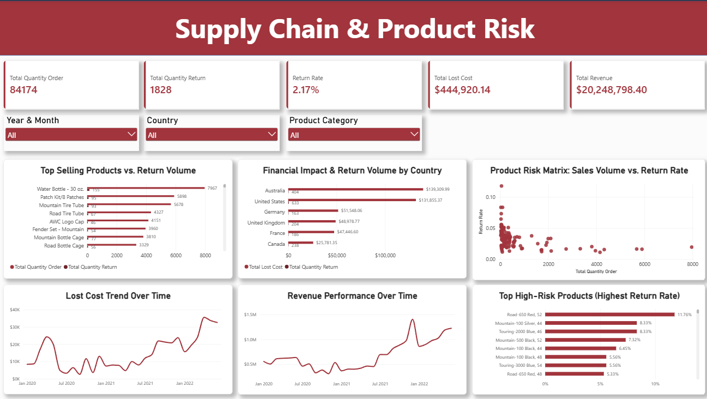

# Supply Chain & Product Risk Analysis

## Executive Summary
Proyek ini bertujuan untuk menganalisis performa rantai pasok (supply chain) dan tingkat risiko produk berdasarkan volume penjualan, pengembalian barang (return), serta dampak kerugian finansial (lost cost). Analisis ini membantu perusahaan mengidentifikasi produk berkualitas rendah, wilayah dengan tingkat kerugian tertinggi, serta pola kerugian dari waktu ke waktu untuk mendukung pengambilan keputusan berbasis data.



---

## Dataset & Sources
Dataset yang digunakan dalam proyek ini berasal dari **AdventureWorks Sample Database** oleh Microsoft.
- **Dataset Link:** [AdventureWorks Database on Kaggle](https://www.kaggle.com/datasets/ahmedibabdelrahman/adventureworks)

---

## Business Problem
1. **Financial Loss from Returns:** Pengembalian barang yang tinggi dapat menggerus margin keuntungan perusahaan akibat biaya operasional dan kerugian nilai produk (*lost cost*).
2. **High-Risk Products:** Kurangnya visibilitas mengenai produk mana yang memiliki tingkat *return rate* tinggi dibandingkan dengan volume penjualannya.
3. **Geographic Risk:** Ketidakjelasan mengenai wilayah (*country*) yang menyumbang tingkat kerugian finansial terbesar akibat pengembalian produk.

---

## Key Metrics & Performance Overview
- **Total Quantity Order:** 84,174 unit
- **Total Quantity Return:** 1,828 unit
- **Return Rate:** 2.17%
- **Total Lost Cost:** $444,920.14
- **Total Revenue:** $20,248,798.40

---

## Key Insights & Findings

### 1. Product Quality & Risk Analysis
- Kategori produk sepeda dan komponen utama (*Bikes/Frames*) memiliki tingkat retur jauh di atas rata-rata keseluruhan (2.17%).
- **Road-650 Red, 52** mencatatkan tingkat pengembalian tertinggi yaitu **11.76%**, diikuti oleh **Mountain-100 Silver, 44** (**8.33%**) dan **Touring-2000 Blue, 46** (**8.33%**).
- Meskipun produk seperti *Water Bottle 30 oz.* memiliki volume penjualan tertinggi (7,967 unit), tingkat retur absolutnya berada dalam batas aman.

### 2. Geographic Risk Analysis
- **Australia** dan **United States** merupakan penyumbang *Lost Cost* terbesar.
- Australia mencatatkan nilai kerugian tertinggi sebesar **$139,309.99** dengan total 404 retur.
- United States mencatatkan kerugian sebesar **$131,855.37** dengan total 633 retur.
- Hal ini menunjukkan bahwa pengembalian barang di Australia didominasi oleh produk dengan harga/biaya per unit yang lebih tinggi dibandingkan wilayah lain.

### 3. Time Series & Revenue Trend
- Tren *Total Revenue* dan *Total Lost Cost* menunjukkan pola pertumbuhan searah sejak Januari 2020 hingga Januari 2022.
- Terjadi lonjakan pendapatan (*peak revenue*) dan lonjakan kerugian (*peak lost cost*) pada periode akhir tahun (Q4), bertepatan dengan musim liburan/penjualan tinggi.

---

## Actionable Recommendations
1. **Evaluasi Kualitas Lini Sepeda (Road & Mountain Bikes):**
   - Lakukan inspeksi kontrol kualitas (QC) serta perbaiki panduan ukuran (*size chart*) dan spesifikasi teknis pada platform e-commerce untuk menekan tingkat retur pada kategori produk *high-risk*.
2. **Mitigasi Biaya Logistik di Wilayah Australia:**
   - Evaluasi standar pengemasan (*packaging*) dan jalur pengiriman jarak jauh ke Australia untuk mengurangi risiko kerusakan barang saat transit.
3. **Manajemen Operasional Saat Peak Season:**
   - Tingkatkan kapasitas pemeriksaan kualitas barang menjelang Q4 untuk mengantisipasi lonjakan retur dan menekan *lost cost* pada periode penjualan tinggi.

---

## Tools & Technologies Used
- **Database Management System:** PostgreSQL (Data Modeling, Querying, & Views Creation)
- **Business Intelligence & Visualization:** Power BI (Data Transformation, DAX Metrics, & Interactive Dashboard Design)
- **Query Language:** SQL

---

## Repository Structure
```text
.
├── raw_data/                 # Dataset mentah yang digunakan dalam analisis
├── script/                   # SQL script untuk data cleaning & views creation
├── Supply Chain & Product Risk.pbix  # File project Power BI Dashboard
├── dashboard.png             # Tangkapan layar Dashboard
└── README.md                 # Dokumentasi proyek
